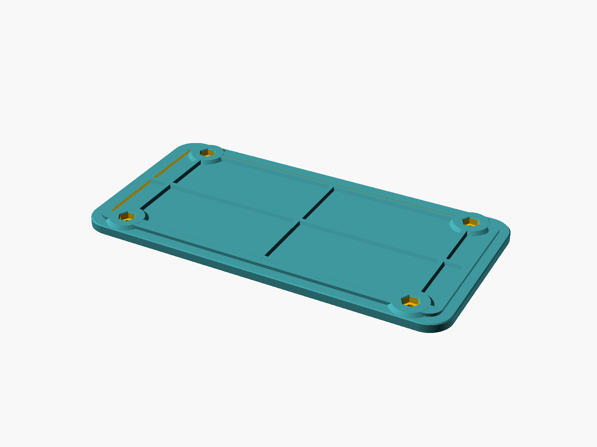
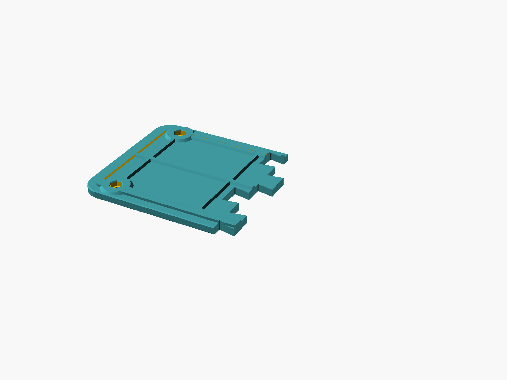
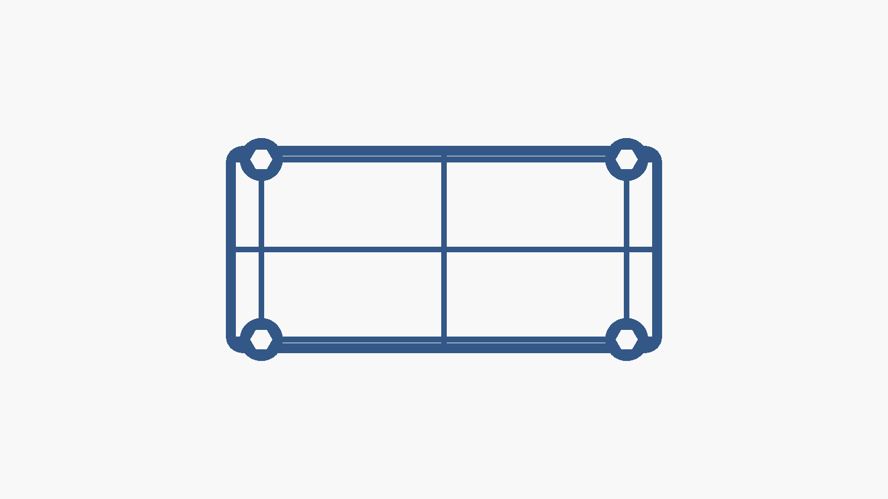
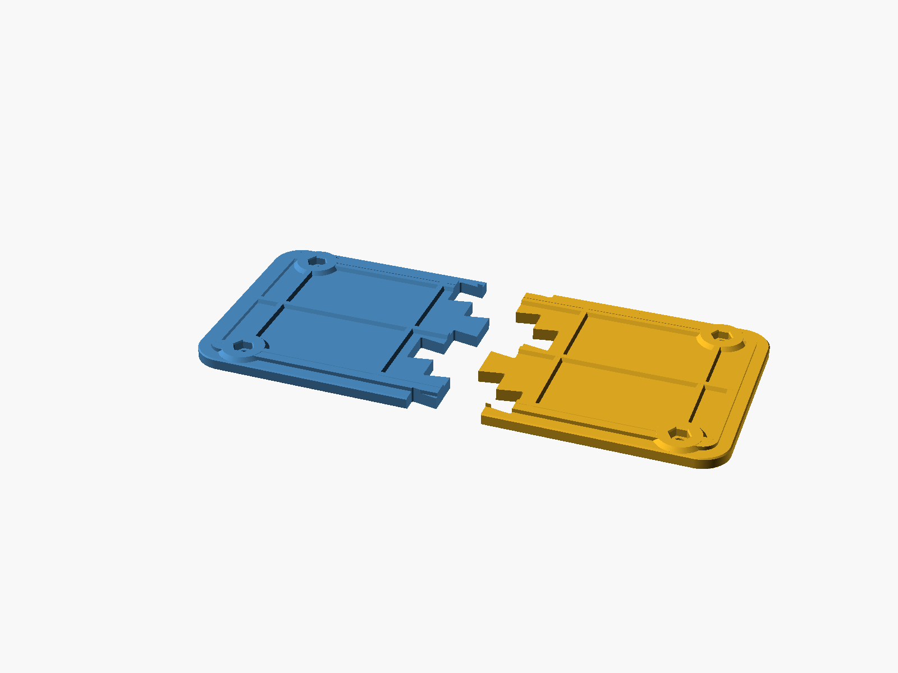
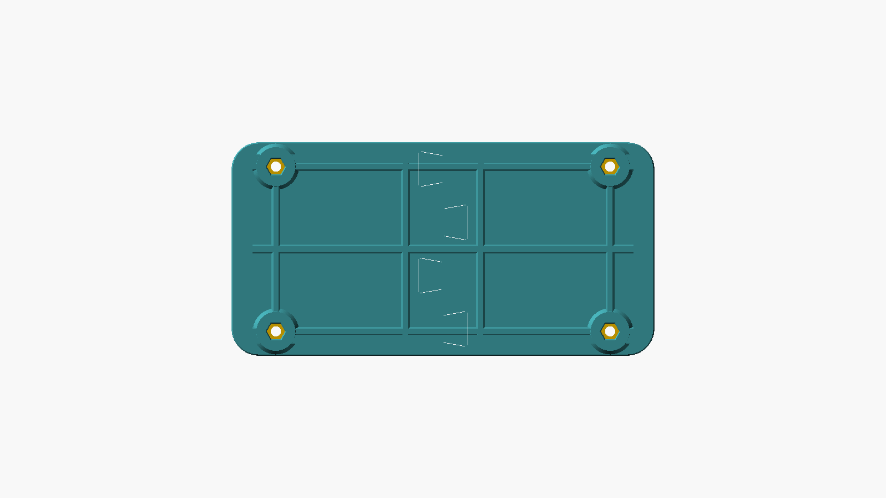

# RAD passenger seat — bolt-on base board

A 3D-printable plate that sits in the bottom of a passenger seat cushion,
inside the cover, and bolts to the bike frame through four hex traps.
Designed for a child's weight plus riding loads, printed in PLA at high infill.



Two versions, same board:

| Version | File | Piece size | Bed needed |
|---|---|---|---|
| One piece | `out/seat_board.stl` | 282.1 × 142.4 × 10 | 282 × 142 mm |
| **Two piece** | `out/seat_board_half.stl` (print **twice**) | 156.9 × 142.4 × 10 | **220 × 220 mm** |
| Two piece, Orca | **`out/seat_board_half.3mf`** | same as above | 220 × 220 mm |

## 3MF for Orca (FlashForge Adventurer 5M)

`out/seat_board_half.3mf` is a plain 3MF core-spec model — one object, unit
millimetres, sitting at Z = 0 with its footprint centred on the origin, which is
where Orca's `-110 .. +110` printable area is centred. Open it with **File →
Open**, pick your `Flashforge Adventurer 5M 0.4 Nozzle` profile, and apply the
settings below.

It carries no embedded slicer settings on purpose. A settings-laden project
file is tied to one Orca version and breaks quietly when presets get renamed;
this one imports into any version of Orca, Flash Studio, Prusa or Bambu and
stays valid. Everything version-specific lives in the settings table instead.

Verified after writing: 3466 triangles, 1731 vertices, 156.90 × 142.40 × 10.00
mm, volume matches the STL to 0.01 cm³, zip and XML re-read cleanly.



## Height budget and why the section looks like this

The only dimension the cover cares about is the **overall height — 10 mm**.
That number is a single parameter:

```scad
total_height = 10.0;   // the envelope that must fit inside the cover
thickness    =  7.5;   // how much of it is plate
```

Everything above the plate (ribs, rim, bolt pads) is packed into
`total_height - thickness`. So you can trade plate for ribs without ever
changing the thing that has to fit.

At a fixed height, **plate is worth more than rib**. Stiffness across the width
goes with the cube of plate thickness, and the plate is continuous over the
whole 151 mm; a rib only acts over its own 6 mm. Modelling a T-section over one
86 mm rib bay:

| | 7 mm plate + 3 mm ribs | **7.5 mm plate + 2.5 mm ribs** |
|---|---|---|
| Second moment of area, per bay | 2909 mm⁴ | **3398 mm⁴ (+17 %)** |
| Section modulus, tension face | 798 mm³ | **879 mm³ (+10 %)** |
| Overall height | 10 mm | **10 mm** |
| Solid volume | 307.0 cm³ | **321.6 cm³** |

Same height, 17 % stiffer in bending, at the cost of 4.8 % more material. That
is still the best trade available inside the envelope, though the gain is
smaller than it was at 12 mm.

If your cover is tighter than 10 mm, the next sensible step is
`total_height = 8.5` with `thickness = 6.5` — that leaves 3 mm of material
under each hex trap, about the practical minimum.

**Perimeter rim.** A closed 6 mm rib now runs around the whole board, 8 mm in
from the edge, tying the grid into a real torsion box. This is the single
biggest gain against the twisting a rider puts through the seat, and it costs
only 2.5 mm of the height you were already spending.



## Why M6

The trap resists rotation through the six flats, and the bolt head bears on the
ring of material around the through hole. Both scale with head size:

| | **M6 (chosen)** | M8 |
|---|---|---|
| Hex head across flats | **10 mm** | 13 mm |
| Through hole | **6.8 mm** | 9.0 mm |
| Bearing ring under the head | **1.6 mm wide, 50 mm²** | 2.0 mm wide, 83 mm² |
| Relative torque before the shoulder yields | **1.0×** | 1.65× |

M8 is the stronger joint, but it needs a 9.0 mm through hole and the frame is
drilled for M6. Opening the frame holes is more work and more risk than the
extra shoulder torque is worth, so the board drops back to M6 — a 6.8 mm hole
and a 10 mm trap.

**Check the frame holes clear 6.8 mm before you commit.**

## Default dimensions (mm)

| Item | Value |
|---|---|
| Seat length / width | 292.1 × 152.4 (11.5" × 6") |
| Board length / width | 282.1 × 142.4 (5 mm clearance per side) |
| Corner radius | 18 |
| **Plate thickness** | **7.5** |
| **Rib / rim / pad height** | **2.5** |
| **Overall height** | **10.0** |
| Perimeter rim | 6 mm wide, 8 mm in from the edge |
| Bolt pattern, eye to eye | 223 × 110, centred |
| Bolt pads | ⌀26 |
| Bolt holes | ⌀6.8 through (M6 clearance) |
| Hex traps | 10.6 mm across flats, 5.5 mm deep, 0.8 mm lead-in |
| Material under each trap | 4.5 mm |
| Seam teeth (two-piece) | 4, 16 mm deep, 18 mm root, 10° undercut |

Meshes: one-piece 5440 triangles, 321.6 cm³ solid, 282.10 × 142.40 × 10.00 mm.
Half 3466 triangles, 161.1 cm³, 156.90 × 142.40 × 10.00 mm. Both watertight
with outward normals; the two halves union back to the full board with no
interference.

Expect roughly **250–265 g** of filament for the one-piece, or 125–130 g per
half, at the settings below.

## Print settings — PLA

Print **flat, traps and ribs facing up**. No supports, no raft. The layer plane
stays parallel to the board, which is the strong direction for FDM.

| Setting | Value |
|---|---|
| Nozzle | 0.4 mm |
| Layer height | 0.2 mm (first layer 0.25) |
| Perimeters | **6** — this is the load path |
| Top / bottom solid layers | 5 / 5 |
| Infill | 50 % gyroid |
| Nozzle / bed | 215–220 °C / 60 °C |
| Speed | 40 outer wall, 60 inner wall, 80 infill mm/s |
| Brim | 5 mm |
| Supports / ironing | off |

Those speeds are deliberately conservative — layer adhesion and wall quality
carry the load, so don't scale them up for the time saved. Use dry PLA and
**do not anneal**; it warps a part this size. If the board will see hot-car or
direct-sun temperatures, print PETG or ASA instead.

**Bolt pads.** At 6 perimeters the shoulder under every bolt head already
prints solid, so the clamp load never crosses infill. To make the whole 26 mm
pad solid as well, load `out/bolt_pad_modifier.stl` as a modifier on the 3MF and
set its sparse infill to 100 %. If you would rather not use modifiers, set 8
walls globally — about 10 % more material — and every pad is effectively solid.

## Two-piece interlock

The split is at the board's centre line, `x = 0`, so no bolt straddles the
seam and each half carries two bolt stations.

**Why a constant-Z dovetail comb.** Any joint that varies through the
thickness — a half-lap, a rabbet, a dovetail keyed in Z — puts a horizontal face
or an overhang inside the part, so it either needs supports or prints as a
sagging bridge, and the joint faces come out neither square nor accurate. A
profile that is constant through the thickness prints as a plain extrusion:
both halves print flat, unsupported, and the mating faces come off the bed
square and dimensionally exact.


**Why dovetail and not a plain finger joint.** Bending puts the bottom face of
the seam in tension, which is what peels a butt or finger joint open. Each
tooth is 16 mm deep and 10° undercut, so it is wider at its tip than at its
root: the halves physically cannot separate in X, and the load rides on the
flanks as bearing instead of hanging entirely on the glue.

**Why the halves are identical.** The tooth pattern is odd about `y = 0` —
teeth at y = −57 and +19, sockets at −19 and +57. Rotate one part 180° about Z
and its teeth land exactly in the other's sockets. So: **print one file twice,
turn one part around, drop it in.**



Every joint face is offset 0.15 mm per side, giving a 0.30 mm bond line — loose
enough to assemble, tight enough for medium CA gel or epoxy. The inner cross
ribs sit at x = ±25 so the seam runs through a clean flat band instead of
splitting a rib down its centre. The rim is cut at the two long-edge midpoints
and glues back together.



## Assembly

1. Dry-fit the halves (rotate one 180°), then separate.
2. Clean the joint faces with IPA; a light 400 grit scuff helps.
3. Glue. **Epoxy is stronger on PLA** and forgiving of the 0.3 mm bond line;
   medium CA gel is faster and fine because the dovetail carries the tension.
   Thin CA is too runny.
4. Press together, clamp or wrap tape around the board, wipe the squeeze-out.
5. Drop the four M6 bolts into the traps, lower onto the frame, and **snug to
   about 1.5–2 N·m**. The head bears on a 1.6 mm plastic shoulder, so the
   plastic, not the bolt, sets the limit — the M6 shoulder is smaller than the
   old M8 one and crushes at lower torque. Threadlocker beats more torque.

## Files

| File | What it is |
|---|---|
| `out/seat_board.stl` | One-piece print mesh |
| `out/seat_board_half.stl` | Half — print twice, rotate one 180° |
| `out/seat_board_half.3mf` | Half as a 3MF, centred for a 220 mm bed |
| `out/bolt_pad_modifier.stl` | 100 %-infill modifier for the two pads on a half |
| `seat_board_lib.scad` | Shared geometry and parameters |
| `seat_board.scad` | One-piece wrapper |
| `seat_board_split.scad` | Two-piece wrapper + seam (`show = half / pair / exploded / seam`) |
| `bolt_pad_modifier.scad` | Source for the modifier volume |
| `make_3mf.py` | STL → validated 3MF converter |
| `check_stl.py` | Watertight / volume / bbox check |
| `clean_png.py` | Strips the `eXIf` chunk OpenSCAD adds to every render |
| `check_pair.scad` | Interference test between the two halves |
| `slice_check.scad` | Plan-slice debug view of the rib grid |
| `preview_hole.scad` | Section through a bolt station |
| `build.sh` | Regenerate everything |

## Changing the model

```scad
total_height = 10.0;  // the cover envelope - change this first
thickness    =  7.5;  // plate; ribs get the remainder
bolt_hole_d  =  6.8;  // M6 clearance (M8 -> 9.0)
hex_af       = 10.0;  // M6 hex head (M8 -> 13.0)
seam_gap     = 0.15;  // raise to 0.25 if your printer runs tight
seam_teeth   =  4;    // must stay even for identical halves
```

Rebuild with `./build.sh` (needs OpenSCAD and Python 3 on your PATH; the
helper scripts use only the standard library).

## Still worth confirming

- Frame holes clear M6 (6.8 mm).
- Actual cushion corner radius — 18 mm is a guess.
- Cover internal height: 10 mm is the design point; drop to `total_height = 8.5`
  if it is tight.

## License

MIT — see [LICENSE](LICENSE).
